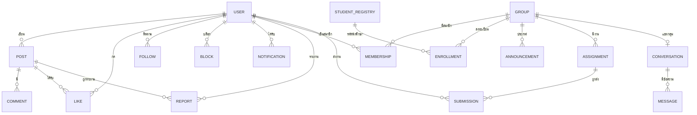

# การออกแบบฐานข้อมูล UniVibe

ฐานข้อมูล MongoDB ชื่อ `univibe` ใช้ Mongoose กำหนด schema และกฎตรวจข้อมูลของทุกคอลเลกชัน

## ภาพรวมความสัมพันธ์

## คอลเลกชัน

| คอลเลกชัน | หน้าที่ | ฟิลด์สำคัญ | Index สำคัญ |
|---|---|---|---|
| `registry_students` | ทะเบียนนักศึกษาจำลอง ใช้ยืนยันตอนสมัคร | studentId, fullName, birthDate (YYYY-MM-DD), faculty, major, status (student/alumni) | studentId ไม่ซ้ำ |
| `users` | บัญชีผู้ใช้ | username, email, passwordHash (bcrypt, ไม่ถูกดึงโดยปริยาย), role (user/teacher/admin), studentId, status, staffId, approval, isSuspended | username, email, studentId, staffId ไม่ซ้ำ |
| `groups` | กลุ่ม 2 ประเภท: `course` (แอดมินสร้าง) และ `general` (ผู้ใช้สร้าง) | type, name, privacy, owner, course{code, section, semester, teachers[], schedule[{day, startMin, endMin, room}]} | code+section+semester ไม่ซ้ำ (เฉพาะกลุ่มรายวิชา) |
| `memberships` | สมาชิกกลุ่มและคำขอเข้ากลุ่ม | group, user, role (owner/manager/member), status (active/pending), source | group+user ไม่ซ้ำ |
| `enrollments` | ข้อมูลลงทะเบียนเรียนจำลอง | studentId, group | studentId+group ไม่ซ้ำ |
| `posts` | โพสต์ | author, text, images[], visibility (public/followers), hashtags[], likesCount, commentsCount | author+createdAt, hashtags+createdAt |
| `comments` | คอมเมนต์ | post, author, text, images[] | post+createdAt |
| `likes` | ไลก์โพสต์ | user, post | user+post ไม่ซ้ำ |
| `follows` | ความสัมพันธ์ติดตาม | follower, following | follower+following ไม่ซ้ำ |
| `blocks` | การบล็อก | blocker, blocked | blocker+blocked ไม่ซ้ำ |
| `notifications` | แจ้งเตือน (รวมแจ้งเตือนอัตโนมัติ) | user, type, actor, link, readAt, dedupeKey | dedupeKey ไม่ซ้ำ (กันเตือนซ้ำ) |
| `announcements` | ประกาศในกลุ่มรายวิชา | group, author, title, body | group+createdAt |
| `assignments` | งานในกลุ่มรายวิชา | group, title, dueAt, closeAt, maxScore | group+dueAt |
| `submissions` | งานที่นักศึกษาส่ง | assignment, student, file{path, originalName, size}, isLate, score, feedback | assignment+student ไม่ซ้ำ (ส่งซ้ำ = แทนที่) |
| `reports` | รายงานโพสต์ | reporter, post, reason, status (open/resolved/dismissed) | reporter+post ไม่ซ้ำ |
| `conversations` | ห้องแชท `direct` (1 ต่อ 1) และ `group` | type, members[], pairKey, group, lastMessageAt | pairKey ไม่ซ้ำ, group ไม่ซ้ำ |
| `messages` | ข้อความแชท | conversation, sender, text, images[], readBy[], isDeleted | conversation+createdAt |
| `sessions` | session ล็อกอิน (สร้างโดย connect-mongo) | — | — |

## หลักการออกแบบที่ตัดสินใจ

- **กลุ่มรวมคอลเลกชันเดียว** (`groups` + `memberships`) แยกประเภทด้วยฟิลด์ `type` ส่วนคำขอเข้ากลุ่มคือ membership ที่ `status = pending` ลดจำนวนคอลเลกชันและใช้ลอจิกสมาชิกร่วมกัน
- **ทะเบียนและข้อมูลลงทะเบียนอ้างด้วยรหัสนักศึกษา** ไม่ใช่ user เพราะนักศึกษาอาจยังไม่มีบัญชี
- **วันเกิดเก็บเป็นข้อความ `YYYY-MM-DD`** เพื่อเทียบตรงกับช่องวันที่ในฟอร์ม โดยไม่ติดปัญหาเขตเวลา
- **เวลาเรียนเก็บเป็นนาทีนับจากเที่ยงคืน** (`startMin`, `endMin`) ทำให้ตรวจเวลาชนกันด้วยการเปรียบเทียบตัวเลข
- **ลบแบบ soft delete** (`isDeleted`) กับโพสต์ คอมเมนต์ ข้อความ และบัญชี เพื่อคงเนื้อหาและประวัติการตัดสินใจของแอดมิน
- **ตัวนับ `likesCount`/`commentsCount`** เก็บในโพสต์เพื่อให้ฟีดโหลดเร็วโดยไม่ต้องนับทุกครั้ง
- **ไฟล์อัปโหลดเก็บในดิสก์** (`uploads/`) เก็บเฉพาะเส้นทางไฟล์ในฐานข้อมูล
- **ผู้เขียนที่ลบบัญชีแล้ว** ลบเฉพาะข้อมูลส่วนตัวใน `users` (ตั้ง `isDeleted`, ชื่อเป็น "บัญชีที่ถูกลบ", ถอดรหัสนักศึกษาออกเพื่อให้สมัครใหม่ได้) ส่วนโพสต์ คอมเมนต์ และข้อความยังอยู่ และลบ follows/memberships/notifications ของบัญชีนั้น
- **แจ้งเตือนกันซ้ำด้วย `dedupeKey`** เช่น `like:<postId>:<userId>` ทำให้กดไลก์-เลิกไลก์วนไปมาไม่สร้างแจ้งเตือนซ้ำ
- **แบ่งหน้าฟีดด้วย cursor** (`_id` ของโพสต์) แทนเลขหน้า เพราะ `_id` เรียงตามเวลา โหลดต่อได้ถูกต้องแม้มีโพสต์ใหม่เข้ามา
- **ห้องแชทแบบเดียวกันสองชนิด** (`conversations`): `direct` เก็บสมาชิก 2 คนและ `pairKey` (id สองคนเรียงลำดับ) เพื่อไม่ให้สร้างห้องซ้ำ ส่วน `group` ผูกกับกลุ่มและใช้รายชื่อสมาชิกจาก `memberships` จึงไม่ต้องเก็บสมาชิกซ้ำสองที่
- **"อ่านแล้ว" เก็บใน `messages.readBy`** (รายชื่อผู้อ่าน) จำนวนที่ยังไม่อ่านคำนวณจากข้อความที่ผู้ส่งไม่ใช่เรา และเราไม่อยู่ใน `readBy`
- **สถานะออนไลน์ไม่เก็บในฐานข้อมูล** แต่นับจำนวนการเชื่อมต่อ Socket.io ของแต่ละผู้ใช้ในหน่วยความจำของเซิร์ฟเวอร์ (หลายแท็บยังนับเป็นออนไลน์จนกว่าจะปิดครบ)
- **ข้อความที่ลบ** ล้างเนื้อหาและรูปออกจริง แต่คงแถวไว้ (`isDeleted`) เพื่อให้ลำดับบทสนทนาไม่ขาด
- **สมาชิกวิชา (`memberships`) กับการลงทะเบียน (`enrollments`) แยกกัน** `enrollments` คือข้อมูลจากทะเบียนที่อ้างด้วยรหัสนักศึกษา (นักศึกษายังไม่ต้องมีบัญชี) ส่วน `memberships` คือสิทธิ์เข้ากลุ่มจริงของผู้ใช้ ฟิลด์ `source` บอกที่มา: `registration` (ลงทะเบียน), `assigned` (แอดมินกำหนดอาจารย์ผู้ดูแล) และ `request` (นักศึกษาขอเข้าร่วมกรณีพิเศษ จะเป็น `pending` จนกว่าอาจารย์หรือแอดมินอนุมัติ) เมื่อสมัครบัญชีหรือเข้าสู่ระบบ ระบบจะสร้าง membership จาก enrollment ให้อัตโนมัติ (`joinRegisteredCourses`) จึงลงทะเบียนเพิ่มทีหลังก็เข้ากลุ่มได้
- **อาจารย์ผู้ดูแลเก็บ 2 ที่** `groups.course.teachers[]` (ใช้ตรวจสิทธิ์และตรวจเวลาสอนซ้อน) และ membership ที่ `role = manager` (ให้เข้าแชทและเห็นในรายชื่อสมาชิก) ฟังก์ชันของแอดมินซิงก์ทั้งสองที่ให้ตรงกันทุกครั้ง
- **การตรวจเวลาชน** ทำที่เซิร์ฟเวอร์ภายในภาคเรียนเดียวกัน: ห้องเดียวกันหรืออาจารย์คนเดียวกันที่ช่วงเวลาซ้อนกันคือชนระดับบล็อก ส่วนนักศึกษาที่มีวิชาอื่นซ้อนคือชนระดับเตือน (ยืนยันข้ามได้) ใช้ชุดตรวจเดียวกันทั้งตอนแอดมินสร้างวิชาและตอนอาจารย์แก้เวลาเรียน
- **งาน (`assignments`) มีสองเวลา** `dueAt` กำหนดส่ง (ส่งหลังจากนี้ติดป้าย `isLate`) และ `closeAt` ปิดรับ (หลังจากนี้ส่งไม่ได้) โดยบังคับ `closeAt >= dueAt` ที่ระดับ schema
- **การส่งงาน (`submissions`) ไม่ซ้ำต่อคน** index `assignment+student` เป็น unique ส่งซ้ำคือแทนที่ไฟล์เดิม (ลบไฟล์เก่าจากดิสก์) และล้าง `score`, `feedback`, `gradedAt`, `gradedBy` เพื่อให้ตรวจใหม่ เพราะคะแนนเดิมเป็นของไฟล์เก่า
- **ไฟล์ส่งงานเก็บใน `uploads/submissions/` ด้วยชื่อสุ่ม** เก็บชื่อไฟล์เดิม (`originalName`) ไว้ในฐานข้อมูลเพื่อใช้ตอนดาวน์โหลด และไม่ให้เปิดผ่าน `/files` เพราะต้องตรวจสิทธิ์รายงาน
- **ประกาศและงานลบแบบ soft delete** (`isDeleted`) และการลบวิชาก็ซ่อนด้วย `isDeleted` ข้อมูลงานและคะแนนไม่หาย
- **`dedupeKey` ของแจ้งเตือนอัตโนมัติ** ใช้กันเตือนซ้ำเมื่องานเบื้องหลังรันทุก 60 วินาที ได้แก่ `class:<groupId>:<วันที่>:<startMin>:<userId>`, `assignment_24h:<assignmentId>:<dueAt>:<userId>`, `assignment_last:<assignmentId>:<dueAt>:<userId>` โดยฝัง `dueAt` ไว้ในคีย์ ถ้าอาจารย์เลื่อนกำหนดส่งก็จะได้รับการเตือนรอบใหม่ และผู้ที่ส่งงานแล้วจะไม่ถูกเลือกเป็นผู้รับเลย
- **การเตือนคาบเรียนคำนวณตามเขตเวลา Asia/Bangkok** ไม่ขึ้นกับเขตเวลาของเครื่องเซิร์ฟเวอร์ และเตือนเฉพาะภาคเรียนล่าสุด
- **รายงานโพสต์ (`reports`) หนึ่งแถวต่อหนึ่งคนที่รายงาน** มี unique index `reporter+post` กันรายงานซ้ำ ส่วนหน้าแอดมินรวมแถวของโพสต์เดียวกันเป็นกลุ่มตอนแสดงผล (ไม่ต้องเก็บตัวนับแยก) เมื่อแอดมินตัดสิน ทุกแถว `open` ของโพสต์นั้นถูกอัปเดตพร้อมกันเป็น `resolved` (ลบโพสต์) หรือ `dismissed` (ไม่พบการละเมิด) พร้อม `handledBy`, `handledAt`, `resolutionNote` และไม่ลบแถวทิ้ง เพื่อเก็บประวัติการตัดสินใจไว้ตรวจสอบ
- **ผลการรายงานส่งเป็นแจ้งเตือน `report_result`** ใช้ `dedupeKey = report_result:<reportId>` จึงไม่แจ้งซ้ำแม้กดซ้ำ ถ้าโพสต์ถูกลบแจ้งเตือนจะไม่แนบลิงก์ (เปิดโพสต์ไม่ได้แล้ว)
- **การระงับบัญชีเป็นแค่ธง** `users.isSuspended` กับ `suspendedReason` ไม่ลบข้อมูล ปลดระงับแล้วใช้งานต่อได้เหมือนเดิม ส่วนผลทันทีเกิดจากการตรวจธงนี้ทุกคำขอ (`loadUser`) และการตัด Socket.io โดยตรงตอนระงับ

